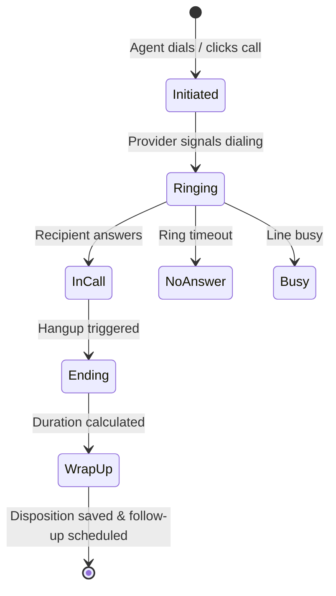
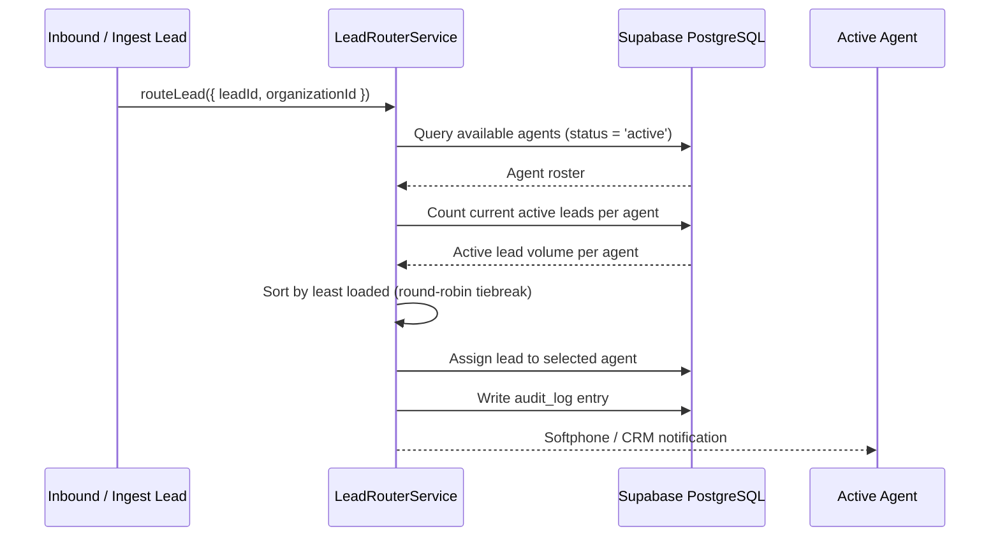

# Lander Call Center CRM — Architecture Specification

## 1. System Architecture Overview

Lander Call Center CRM is structured as a modern, high-performance modular platform designed for multi-tenant call centers, lead acquisition teams, and distributed sales forces.

```
┌─────────────────────────────────────────────────────────────────────────────┐
│                       Next.js 14 Frontend (React 18)                         │
│  - App Router, React Hook Form, Zod, Recharts, Tailwind CSS, Lucide Icons   │
│  - Persistent AppShell with Live Softphone Dialer (DTMF, Mute, Hold, Timer) │
│  - Lead Management, Call Tracking, Campaign Management, Agent Availability   │
└─────────────────────────────────────┬───────────────────────────────────────┘
                                      │ HTTPS / REST + Supabase JWT
                                      ▼
┌─────────────────────────────────────────────────────────────────────────────┐
│                          Express.js REST API Layer                          │
│  - Middleware: Helmet, Dynamic CORS, Rate Limiting, Winston/Morgan Logging │
│  - Auth & RBAC: JWT validation, 10-Role Permission Checking                 │
│  - Telephony Service: Agnostic Adapter (Twilio Voice API / Mock Simulator)   │
│  - Lead Routing Engine: Least-loaded & Round-robin agent assignment         │
│  - Background Jobs: Cron overdue follow-up processor & notification dispatch │
└───────────────────────┬───────────────────────────────┬─────────────────────┘
                        │ Supabase JS (Service Role)     │ REST / Webhook
                        ▼                               ▼
┌──────────────────────────────────────────┐   ┌──────────────────────────────┐
│         Supabase PostgreSQL Core         │   │   Telephony Service Provider │
│  - 15 Relational Tables with FK Integrity│   │  - Twilio Voice REST API     │
│  - Multi-tenant Isolation via RLS        │   │  - Webhook Event Callbacks   │
│  - Row Auditing & Webhook Deduplication  │   │  - Realtime Audio / TwiML    │
└──────────────────────────────────────────┘   └──────────────────────────────┘
```

---

## 2. Telephony State Machine & Softphone Integration

The platform features an agnostic telephony adapter architecture that decouples call handling logic from specific carrier implementations.

### 2.1 Call State Machine



### 2.2 Agnostic Telephony Architecture

The backend implements `TelephonyProvider` base class:
- `MockProvider`: Provides deterministic state transitions (dialing, ringing, audio duration, hangup) for local development, automated testing, and offline demos.
- `TwilioProvider`: Uses Twilio's Programmable Voice REST API (`/Calls.json`) to initiate live PSTN/SIP calls and receive call status webhooks.
- `TelephonyService`: Coordinates provider selection, logs initial records into `calls` table, triggers audio session, updates database on termination, and logs disposition wrap-ups with automated follow-ups.

---

## 3. Automated Lead Routing Engine

The lead distribution engine ensures inbound or imported leads are balanced efficiently across online call center staff.



---

## 4. Multi-Tenant Data Isolation & Security Model

1. **Database Row Level Security (RLS)**: Every row across all 15 tables contains an `organization_id` foreign key. Supabase RLS policies enforce `organization_id = (auth.jwt() ->> 'organization_id')::uuid`.
2. **Backend RBAC Validation**: Express route handlers enforce role-based permissions (`requirePermission('leads.assign')`, `requirePermission('calls.initiate')`) prior to executing database operations.
3. **Privilege Separation**:
   - Frontend uses Supabase Anon Key (subject to strict RLS).
   - Backend Express API runs with Service Role Key (bypassing RLS for system operations, but enforcing tenant authorization programmatically).
