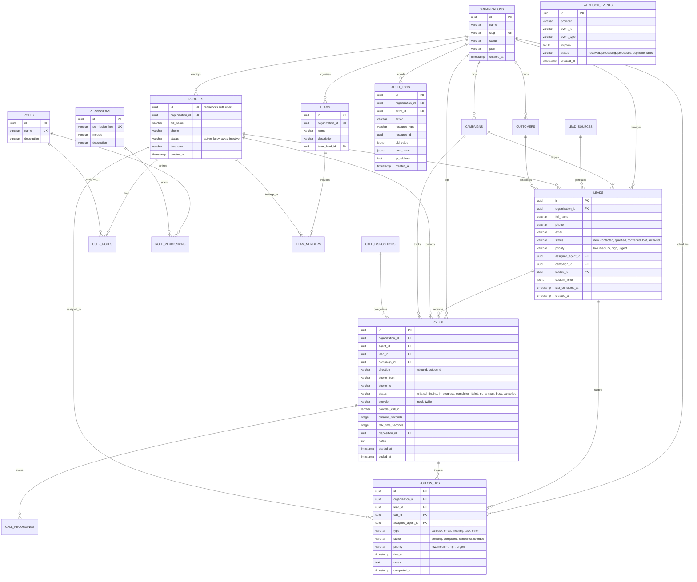

# Lander Call Center CRM — Database Entity Relationship Diagram (ERD)

## 1. Overview

The database layer runs on PostgreSQL hosted via Supabase. It uses 15 core relational tables with strict foreign key integrity, check constraints, default UUID primary keys, and comprehensive Row Level Security policies.

---

## 2. Mermaid Entity-Relationship Diagram

